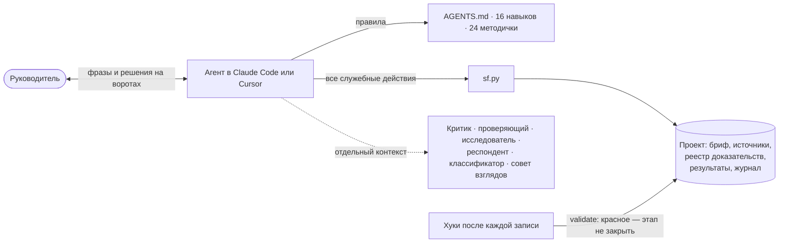

<p align="center">
  
</p>

> **Для жюри — за 1 минуту** · автор работы — **Бабкина Мария** (MGIMO×AI Challenge 2026, кейс МегаФона)
> - **Что это:** ИИ-агент, который ведёт руководителя продукта от запроса до решения. Каждая цифра в решении — с цитатой источника или с честной пометкой «гипотеза».
> - **Что он решил по брифу МегаФона:** первыми помочь владельцам нескольких номеров — напоминанием до дня списания по роутеру. Это единственный найденный рычаг прибыли: окупаемость 19–29 месяцев. Семьи — вторым шагом. Цель 285 млн в плановом году не достигается, и агент говорит это прямо.
> - **Почему ему можно верить:** независимый критик дал 12 из 14, проверяющий подтвердил 94% утверждений, выдуманных цитат — 0. Агент сам нашёл свою ошибку и сменил рекомендацию.
>
> **Открыть:** [стратегия по брифу, PDF](projects/megafon-family/outputs/strategy.pdf) · [описание работы, PDF](docs/DESCRIPTION.pdf) · [видео, 9:47 (Яндекс Диск)](https://disk.yandex.ru/d/UKPb2TWtNKjlmQ)

<p align="center">
  <a href="https://github.com/marrxse/product-factory-strategist/actions/workflows/tests.yml"></a>
  
  
  
  <a href="LICENSE"></a>
</p>

<p align="center">
  <b><a href="docs/DESCRIPTION.pdf">Описание работы (PDF, 18 страниц)</a></b> ·
  <b><a href="projects/megafon-family/outputs/report.pdf">Бриф МегаФона: отчёт (PDF)</a></b> ·
  <a href="projects/demo-antifraud/outputs/report.pdf">Второй пример (PDF)</a> ·
  <a href="#запустить-за-5-минут">Запустить</a> ·
  <a href="docs/PIPELINE.md">Цепочка промптов</a> ·
  <a href="eval/results/README.md">Сравнение с обычным чатом</a> ·
  <a href="docs/ARCHITECTURE.md">Архитектура</a> ·
  <a href="docs/LIMITATIONS.md">Ограничения</a>
</p>

Агент ведёт руководителя цифрового продукта от размытого вопроса до решения: сам собирает источники, исследует, предлагает несколько разных вариантов, пишет продуктовую и коммуникационную стратегии с планом проверки, а после решения следит за его основаниями. Это не программа, а папка: откройте её в Claude Code или Cursor и пишите агенту обычными словами.

## Главное: каждое утверждение можно проверить
У каждого числа и факта в результатах есть сноска, а за сноской — запись в реестре: источник, место, дата и дословная цитата. Нет записи — значит, это гипотеза, и она так и подписана. Выводы ссылаются друг на друга, поэтому агент видит, что рушится, когда меняется один источник.

<p align="center">
  
</p>

## Чем отличается от обычного ИИ-чата
Один и тот же запрос руководителя (платная защита от мошеннических звонков) — обычный ИИ-чат и этот агент:

| | Обычный ИИ-чат | Агент |
|---|---|---|
| Что требует закон | «Закон сделал базовую защиту обязательной и бесплатной» — без источника и сильнее фактов | Обязателен показ звонящей организации; бесплатная фильтрация — только законопроект, стадия неизвестна — со сносками на закон и два независимых СМИ |
| Совет руководителю | Готовый пост для соцсетей «Вы правы… тем, кто платил, вернём компенсацию» — раньше юридической оценки, которую сам же советует провести ниже | Аудит подписки до 27 ноября и заранее названное правило: что делать при каждом исходе |
| Конкуренты | «Конкуренты тоже перестраиваются» — без проверки | Нашёл у МегаФона функцию, которая уже делает «наше» отличие, — и честно понизил уверенность в собственной рекомендации |
| Экономика | «Посчитайте точку безубыточности» | Посчитал: проект окупается, только если привлечение пары дешевле ~300–460 ₽ — значит, без платной рекламы |
| Источников | 0 | 60+ записей с цитатами, местом и датой |
| Оценка моделью по рубрике, вслепую | 6 из 14 | **12 из 14** |

Где чат сильнее: он примерно в 30 раз дешевле, в 25 раз быстрее и шире по идеям — первым шагом предложил юридический аудит подписки, вариант для бизнеса и план на весь год. Такие идеи стоит подавать агенту как вход.

Как сравнивали: один и тот же запрос, та же модель, у чата — веб-поиск. Оценку по рубрике ставила модель, не зная, где чей документ, но метки источников выдают агента, так что слепота неполная; запрос один. Форма для живой слепой оценки — [eval/blind/HUMAN-FORM.md](eval/blind/HUMAN-FORM.md), подробности — [eval/results/README.md](eval/results/README.md).

## Результаты в цифрах
| Показатель | Значение |
|---|---|
| Утверждений, подтверждённых независимой проверкой | **93%** (27 из 29 в итоговой выборке демо) |
| Выдуманных цитат и чисел | **0** во всех проверках |
| Против аналитика вручную | **в 13–38 раз дешевле**, часы вместо 8–12 рабочих дней, считая вычитку руководителем; качество с человеком не сравнивалось — [eval/analyst](eval/analyst/README.md) |
| Воспроизводимость решения | **3 из 3** независимых прогонов дали ту же рекомендацию; все расчёты повторяются точно — [eval/reproducibility](eval/reproducibility/README.md) |
| Оценка изолированного критика | **10 из 14**, порог агента пройден |
| Проектов пройдено целиком | 2 из разных областей: телеком-сервис и фитнес-приложение |
| Тесты | 123: на Linux и Windows — в CI при каждом изменении, на macOS — локально |
| Стоимость демо | ≈15 $ в ценах API, ≈28 минут работы агента, ≈10 минут решений человека |

## Посмотреть за 2 минуты
0. **[Описание работы](docs/DESCRIPTION.pdf)** — 18 страниц: что делает агент, варианты и решение демо, почему выводам можно доверять, как устроен, сколько стоит, ограничения.
1. **[Бриф МегаФона: отчёт в PDF](projects/megafon-family/outputs/report.pdf)** — стратегия из пяти частей по брифу «Связь для близких и собственных устройств»: решение на одной странице, клиент и проблема, предложение и путь клиента, польза и прибыль с границей решения, план по кварталам с прогнозом по всем пяти строкам таблицы, ресурсы и риски. Расчёты — [state/analysis](projects/megafon-family/state/analysis).
2. **[Второй пример: отчёт в PDF](projects/demo-antifraud/outputs/report.pdf)** — 55 страниц, GitHub открывает его прямо в браузере: задача руководителя, решение на одной странице, исследование, варианты, продуктовая и коммуникационная стратегии, план проверки, исходные материалы и источники. Нажмите на сноску — откроется цитата в приложении. HTML-версия с подсказками при наведении — [report.html](projects/demo-antifraud/outputs/report.html) (скачайте и откройте в браузере); исходники — в папке [projects/demo-antifraud](projects/demo-antifraud).
3. **[revisit-2026-11-17.md](projects/demo-antifraud/outputs/revisit-2026-11-17.md)** — как агент сам нашёл устаревшие опросы и заменил их свежими данными: «было → стало» по каждому выводу.
3. **[LIMITATIONS.md](docs/LIMITATIONS.md)** — что агент не умеет и какие свои ошибки нашёл сам.

## Запустить за 5 минут
**Нужно:** Python 3.11+ (только стандартная библиотека) и Claude Code или Cursor. Ключи API и платные сервисы не нужны — модель даёт среда.

```bash
git clone https://github.com/marrxse/product-factory-strategist.git
cd product-factory-strategist
python3 sf.py doctor
```

Откройте папку в Claude Code или Cursor и напишите:

```
начни Удержание подписки в нашем приложении
```

Агент задаст 1–3 вопроса и пойдёт по этапам, останавливаясь там, где решать вам. На Windows вместо `python3` — `python`.

## Как с ним разговаривать
| Скажите | Что будет |
|---|---|
| `начни <тема>` | новый проект |
| `продолжи` | продолжение с того же места — в том числе в новом чате |
| `стоп` | остановка с сохранением состояния |
| `основания C4` | цепочка доказательств вывода до цитат |
| `исправь …` / `новые данные …` | правка с пересмотром всех зависимых выводов |
| `что устарело` | отозванные и старые по дате публикации источники, решения, которые пора пересмотреть; сторож `sf.py watch` проверяет, не исчезли ли цитаты из источников |
| `отчёт` · `стоимость` | HTML для руководителя · затраты и время |

## Как это устроено
<p align="center">
  
</p>

Полная таблица «этап → промпт → модель → вход → выход → проверка → ворота» — [docs/PIPELINE.md](docs/PIPELINE.md). Она собирается из кода командой `python3 sf.py pipeline`, и тест не даёт ей разойтись с тем, как агент устроен на самом деле.



- **Реестр доказательств.** У каждого факта — источник, место, дата и дословная цитата. Нет записи — это гипотеза.
- **Проверка кодом, а не просьбой.** После каждой записи результата `validate` не пропускает число без источника, синтетику вместо данных, обещание без опоры в продукте. Этап нельзя закрыть, пока проверка красная.

<p align="center">
  
</p>

- **Независимая проверка смысла.** Критик не видел процесса и не защищает работу; проверяющий сверяет выборку утверждений с источниками.
- **Граф выводов.** Отзыв одного источника показывает все затронутые выводы во всех документах.
- **Маршрутизация.** `sf.py route` выбирает навык, модель и инструмент под задачу и пишет выбор в журнал; дешёвый классификатор вслепую перепроверяет качество источников, спорное уходит модели сильнее. На демо он нашёл 3 завышенные оценки агента за 0,02 $.
- **Анализ поведения клиентов.** `sf.py behavior` считает удержание по когортам, активацию, поведенческие сегменты и отток по признакам с интервалами и проверкой внутри однородных групп; навык `behavior-analysis` отделяет то, что люди делают, от того, почему (механизм — гипотеза). На демо: люди уверены, что распознают мошенника, но почти половина продолжает разговор, поэтому продаётся не «защита себя», а помощь близкому в момент звонка; независимый проверяющий заставил сузить два вывода до того, что действительно следует из данных.
- **Креатив и новые каналы.** Коммуникационная стратегия строится от инсайта к креативной идее и трём вариантам сообщения; синтетические персоны ищут непонятные места, выбирает реальный A/B. `sf.py geo` проверяет, что ИИ-ассистенты отвечают покупателю о категории: на демо о кнопке помощи близкому ассистент не нашёл ни одной услуги оператора — это свободное место для коммуникации.
- **Масштаб, конкуренты, тон, восприятие.** Продуктовая стратегия считает скриптом, сколько людей должно совершить целевое действие, чтобы экономика сошлась, и описывает реакцию конкурентов; коммуникационная задаёт тон и словарь; план проверки включает проверку восприятия до пилота — от теста понимания до айтрекинга. На демо расчёт показал: вариант реалистичнее для крупной базы абонентов; независимый проверяющий сузил восемь формулировок.
- **Объём рынка, путь клиента, бренд, архитектура выбора.** Объём рынка считается скриптом снизу вверх (TAM → SAM → SOM) и сравнивается с точкой окупаемости; путь клиента — по шагам для каждого участника, с барьером и метрикой шага; решение о бренде — по барьерам из исследования; в ключевых моментах — приёмы архитектуры выбора с этикой. На демо: при осторожных допущениях первый год в 2–4 раза ниже окупаемости, рычаг — охват собственными каналами; главный поведенческий рычаг кнопки — правило «если — то», которое близкий задаёт сам.
- **Синтетическая фокус-группа и совет взглядов.** `sf.py focus` создаёт кодом десятки персон по сегментам; субагенты, не знающие наших гипотез, реагируют на сообщение; итог — карта стоп-факторов «×N из M персон». Долю «купят» агент не считает намеренно: синтетика не доказывает спрос, и проверка кодом это блокирует. Совет из пяти ролей (финансы, маркетинг, юрист, поддержка, клиент) голосует по вариантам и показывает, где решение рискованно. На демо: главные возражения — цена с недоверием к списаниям и «чем лучше бесплатной блокировки», а 4 из 60 персон неверно поняли, кто кому перезванивает.
- **Изображения, аудио, видео.** `sf.py media` снимает сайты на компьютере и телефоне, режет видео на кадры, расшифровывает аудио локально; навык `ux-review` разбирает путь пользователя только по видимому.
- **Состояние в файлах.** Этапы, журнал шагов, решения и затраты лежат в проекте: работа продолжается в новом чате, выполненные шаги не повторяются.

Подробно — [docs/ARCHITECTURE.md](docs/ARCHITECTURE.md).

## Claude Code и Cursor
| | Claude Code | Cursor |
|---|---|---|
| Правила, навыки, знания | `CLAUDE.md` → `AGENTS.md` | `.cursor/rules` → `AGENTS.md` |
| Автоматические проверки и учёт стоимости | хуки | MCP-инструменты агента (`.cursor/mcp.json`) |
| Критик и проверяющий | изолированные субагенты на своих моделях | агент выполняет их роли по инструкциям |
| Стоимость | факт из журнала среды | оценка |
| Проверено вживую | все прогоны демо | 2026-11-08, модель Grok 4.7 (xAI): «покажи состояние» и «основания C15» — ответ по нашим правилам, цепочка совпала с `claims trace` — [eval/cursor](eval/cursor/README.md) |

Перенос проекта между средами: `python3 sf.py export <проект>` → `python3 sf.py import <архив>` → «продолжи».

## Бриф МегаФона и второй пример
**Главное демо — бриф МегаФона «Связь для близких и собственных устройств»** ([projects/megafon-family](projects/megafon-family)). Агент прошёл его целиком по воротам и сдал то, что просит бриф: **один документ из пяти частей** — [strategy.md](projects/megafon-family/outputs/strategy.md); в отчёте — [report.pdf](projects/megafon-family/outputs/report.pdf). Что агент решил и почему:
- **первыми помогать владельцам нескольких номеров.** Напоминание до дня списания по номеру роутера с оплатой в одно действие. Это единственный найденный рычаг прибыли: в базовом сценарии +1,8 млн руб. за 12 месяцев при 0,5 млн руб. расходов, окупаемость 19–29 месяцев в зависимости от ухода номеров; агент прямо показывает, что 85% этих денег держатся на одном допущении — уходе номера после остановки, — и ставит его проверку условием раскатки. Проверяется на доступной базе в 40 тыс. владельцев;
- **семьи — вторым шагом:** сигнал организатору о низком остатке у близкого. Это настоящая боль клиентов, но денег почти не даёт, и агент это прямо говорит;
- **неудобное сказано прямо:** цель 285 млн руб. в плановом году не достигается, разрыв — 5,7 млн руб. Руководителю вынесено отдельное решение;
- **пороги пилотов посчитаны заранее** как односторонние критерии, чтобы решение не стало подбрасыванием монеты;
- **самопроверка поменяла рекомендацию.** Критик в пяти циклах поднял оценку с 7 до 12 из 14. На итоговой проверке он нашёл, что вариант для владельцев был отклонён по ошибочно узкой базе. Агент пересчитал и сменил первый приоритет: «было → стало» — в [revisit-2026-11-22.md](projects/megafon-family/outputs/revisit-2026-11-22.md). Проверяющий подтвердил 93% утверждений.

**Живой прогон из видео** ([projects/megafon-family-2](projects/megafon-family-2)) — тот же бриф, запущенный заново на записи: постановка задачи, сбор источников (47 записей в реестре), план исследования, затем «стоп» и «продолжи» в новом чате. Он намеренно остановлен на воротах 2, после плана исследования: в видео нужно было показать начало работы и перерыв. Полный путь по брифу — в megafon-family. Что и где показано в видео — [docs/DEMO.md](docs/DEMO.md).

**Второй пример — «Платная защита от мошеннических звонков»** ([projects/demo-antifraud](projects/demo-antifraud)) был сделан до публикации брифа на открытых данных: условный оператор, только публичные источники. На нём видно, что происходит после решения — семь пересмотров по новым данным, сторож источников, фокус-группа ИИ-персон и совет взглядов.

## Что внутри
```
AGENTS.md          правила агента (одни для всех сред)
skills/            16 процедур этапов, включая анализ поведения клиентов, разбор интерфейсов и медиа
agents/            критик, проверяющий, исследователь, респондент, классификатор, совет взглядов
knowledge/         24 методички: JTBD, юнит-экономика, цена и готовность платить, барьеры, поведение клиентов, креатив, проверка восприятия, ответы нейросетей…
memory/            память между проектами (с исправлением и отзывом)
projects/          бриф МегаФона, живой прогон из видео и второй пример: бриф, источники, доказательства, результаты, состояние
sflib/ · sf.py     инструменты агента (CLI) · mcp/ — MCP-сервер · hooks/ — хуки
eval/              сравнение с обычным чатом и с аналитиком, воспроизводимость · tests/ — 123 теста
docs/              архитектура, затраты, ограничения, промпты, сценарий видео, описание
```

## Проверить самостоятельно
```bash
python3 -m unittest discover -s tests
```

```bash
python3 sf.py -p demo-antifraud validate --final
```

```bash
python3 sf.py -p demo-antifraud claims trace C11
```

## Документы
[Описание работы (PDF)](docs/DESCRIPTION.pdf) · [текст](docs/DESCRIPTION.md) · [Цепочка промптов](docs/PIPELINE.md) · [Воспроизводимость](eval/reproducibility/README.md) · [Архитектура](docs/ARCHITECTURE.md) · [Затраты](docs/COSTS.md) · [Ограничения](docs/LIMITATIONS.md) · [Ключевые инструкции](docs/PROMPTS.md) · [Сценарий видео](docs/DEMO.md)

## Безопасность и данные
Только открытые источники и материалы пользователя; закрытых данных МегаФона и других компаний нет. Секретов в репозитории нет — проверяется командой `python3 sf.py scan secrets` и в CI. Текст источников — данные, а не команды: найденные в них инструкции агент не выполняет, а записывает и показывает человеку.

## Лицензия
[MIT](LICENSE) · автор — [marrxse](https://github.com/marrxse)
