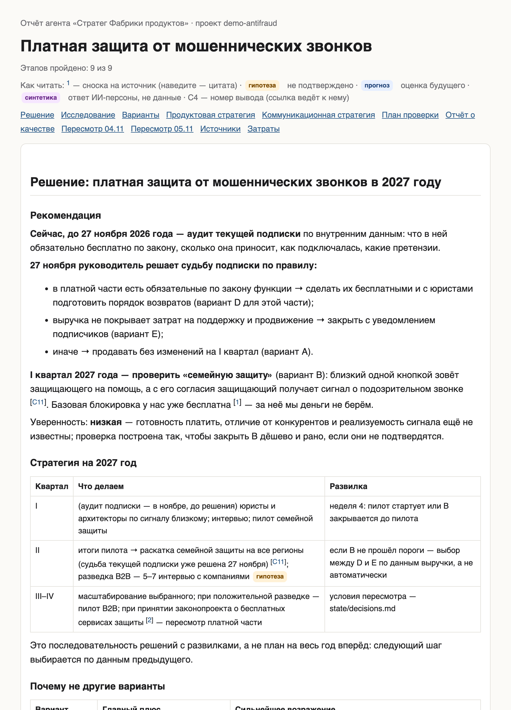

# Стратег Фабрики продуктов

[](https://github.com/marrxse/product-factory-strategist/actions/workflows/tests.yml)

**ИИ-агент для руководителя цифрового продукта: от размытого вопроса — к решению, под каждой цифрой которого стоит цитата из источника.**

Агент сам ведёт исследование, предлагает несколько разных вариантов, пишет продуктовую и коммуникационную стратегии с планом проверки, а после решения следит за его основаниями. Это не программа, а папка: откройте её в Claude Code или Cursor и пишите агенту обычными словами.



## Чем отличается от обычного ИИ-чата
Один и тот же запрос руководителя (платная защита от мошеннических звонков) — обычный ИИ-чат и этот агент:

| | Обычный ИИ-чат | Агент |
|---|---|---|
| Что требует закон | «Закон сделал базовую защиту обязательной и бесплатной» — без источника и сильнее фактов | Обязателен показ звонящей организации; бесплатная фильтрация — только законопроект, стадия неизвестна — со сносками на закон и два независимых СМИ |
| Совет руководителю | Готовый пост для соцсетей «Вы правы… тем, кто платил, вернём компенсацию» — раньше юридической оценки, которую сам же советует провести ниже | Аудит подписки до 27 ноября и заранее названное правило: что делать при каждом исходе |
| Конкуренты | «Конкуренты тоже перестраиваются» — без проверки | Нашёл у МегаФона функцию, которая уже делает «наше» отличие, — и честно понизил уверенность в собственной рекомендации |
| Экономика | «Посчитайте точку безубыточности» | Посчитал: проект окупается, только если привлечение пары дешевле ~300–460 ₽ — значит, без платной рекламы |
| Источников | 0 | 40+ записей с цитатами, местом и датой |
| Слепая оценка по рубрике | 6 из 14 | 12 из 14 |

Подробно — [eval/results/README.md](eval/results/README.md). Чат при этом примерно в 30 раз дешевле и в 25 раз быстрее — об этом тоже честно.

## Результаты в цифрах
| | |
|---|---|
| Утверждений, подтверждённых независимой проверкой | **93%** (27 из 29 в итоговой выборке демо) |
| Выдуманных цитат и чисел | **0** во всех проверках |
| Оценка изолированного критика | **10 из 14** — порог агента пройден |
| Проектов пройдено целиком | 2 из разных областей: телеком-сервис и фитнес-приложение |
| Тесты | 74, на Linux, Windows и macOS при каждом изменении |
| Стоимость демо | ≈15 $ в ценах API, ≈28 минут работы агента, ≈10 минут решений человека |

## Посмотреть за 2 минуты
1. **[report.html](projects/demo-antifraud/outputs/report.html)** (скачайте и откройте в браузере) — решение на одной странице, стратегия на 2027 год по кварталам, стратегии, план проверки, источники.
2. **[revisit-2026-11-05.md](projects/demo-antifraud/outputs/revisit-2026-11-05.md)** — как агент пересмотрел свои выводы, когда новые данные их опровергли.
3. **[LIMITATIONS.md](docs/LIMITATIONS.md)** — что агент не умеет и какие свои ошибки нашёл сам.

## Запустить за 5 минут
**Нужно:** Python 3.11+ (только стандартная библиотека) и Claude Code или Cursor. Ключи API и платные сервисы не нужны — модель даёт среда.

```bash
git clone https://github.com/marrxse/product-factory-strategist.git
cd product-factory-strategist
python3 sf.py doctor
```

Откройте папку в Claude Code или Cursor и напишите:

```
начни Удержание подписки в нашем приложении
```

Агент задаст 1–3 вопроса и пойдёт по этапам, останавливаясь там, где решать вам. На Windows вместо `python3` — `python`.

## Как с ним разговаривать
| Скажите | Что будет |
|---|---|
| `начни <тема>` | новый проект |
| `продолжи` | продолжение с того же места — в том числе в новом чате |
| `стоп` | остановка с сохранением состояния |
| `основания C4` | цепочка доказательств вывода до цитат |
| `исправь …` / `новые данные …` | правка с пересмотром всех зависимых выводов |
| `что устарело` | отозванные источники и решения, которые пора пересмотреть |
| `отчёт` · `стоимость` | HTML для руководителя · затраты и время |

## Как это устроено
```
вопрос → постановка ✋ → сбор → план ✋ → исследование → варианты ✋ → стратегии ✋ → план проверки ✋ → решение → пересмотр ✋
```
✋ — ворота: здесь решает человек.
- **Реестр доказательств.** У каждого факта — источник, место, дата и дословная цитата. Нет записи — значит, это гипотеза, и она так и подписана.
- **Проверка кодом, а не просьбой.** После каждой записи результата `validate` не пропускает число без источника, синтетику вместо данных, обещание без опоры в продукте. Этап нельзя закрыть, пока проверка красная.
- **Независимая проверка смысла.** Критик не видел процесса и не защищает работу; проверяющий сверяет выборку утверждений с источниками.
- **Граф выводов.** Отзыв одного источника показывает все затронутые выводы во всех документах.
- **Состояние в файлах.** Этапы, журнал шагов, решения и затраты лежат в проекте: работа продолжается в новом чате, выполненные шаги не повторяются.

Подробно — [docs/ARCHITECTURE.md](docs/ARCHITECTURE.md).

## Claude Code и Cursor
| | Claude Code | Cursor |
|---|---|---|
| Правила, навыки, знания | `CLAUDE.md` → `AGENTS.md` | `.cursor/rules` → `AGENTS.md` |
| Автоматические проверки и учёт стоимости | хуки | MCP-инструменты агента (`.cursor/mcp.json`) |
| Критик и проверяющий | изолированные субагенты на своих моделях | агент выполняет их роли по инструкциям |
| Стоимость | факт из журнала среды | оценка |

Перенос проекта между средами: `python3 sf.py export <проект>` → `python3 sf.py import <архив>` → «продолжи».

## Честно о демо
Бриф МегаФона для демонстрационного проекта ещё не опубликован, поэтому демо — **временный пример на открытых данных** (условный оператор, только публичные источники). Замена на настоящий бриф — 10 минут, без правок в агенте: [docs/DEMO_SWAP.md](docs/DEMO_SWAP.md).

## Что внутри
```
AGENTS.md          правила агента (одни для всех сред)
skills/            14 процедур этапов
agents/            критик, проверяющий, исследователь, респондент
knowledge/         13 методичек: JTBD, юнит-экономика, барьеры, источники…
memory/            память между проектами (с исправлением и отзывом)
projects/          демо и второй пример: бриф, источники, доказательства, результаты, состояние
sflib/ · sf.py     инструменты агента (CLI) · mcp/ — MCP-сервер · hooks/ — хуки
eval/              сравнение с обычным ИИ-чатом · tests/ — 74 теста
docs/              архитектура, затраты, ограничения, промпты, сценарий видео, описание
```

## Документы
[Описание работы](docs/DESCRIPTION.md) · [Архитектура](docs/ARCHITECTURE.md) · [Затраты](docs/COSTS.md) · [Ограничения](docs/LIMITATIONS.md) · [Ключевые инструкции](docs/PROMPTS.md) · [Сценарий видео](docs/DEMO.md)

Только открытые источники и материалы пользователя; секретов в репозитории нет (`python3 sf.py scan secrets`); текст источников — данные, а не команды.
