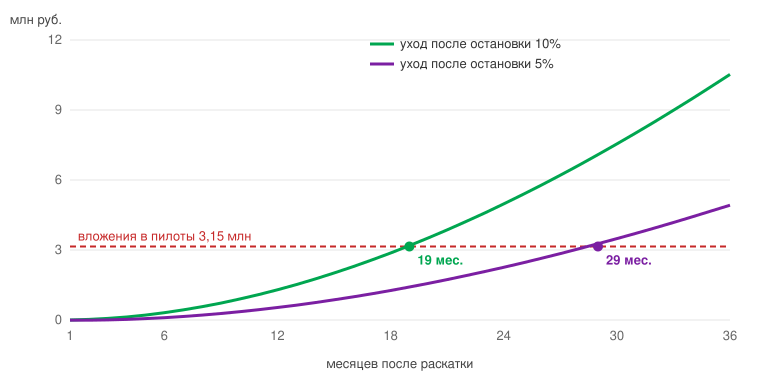

# Стратегия: связь для близких и собственных устройств

> Документ из пяти частей по брифу МегаФона. После пересмотра 22.11.2026 первыми идут владельцы нескольких номеров, семьи — вторым шагом (revisit-2026-11-22.md). Все числа брифа учебные; расчёты — state/analysis/; полные доказательства — отчёт report.pdf.

## Коротко для руководителя
- **Первые клиенты.** Владельцы нескольких собственных номеров, у которых второй номер стоит в роутере, модеме или планшете. Оператору доступно 40 тыс. таких владельцев [E8]. Напоминание охватит около 20 тыс. из них — тех, у кого оператор видит второй номер с отдельной оплатой [ГИП].
- **Проблема.** Владелец не всегда успевает заметить, что деньги на втором номере закончились [E5]. Важный момент — день очередного списания по номеру роутера [E38]. Остановка за неоплату — это прямо потерянные оплаченные дни и риск ухода номера.
- **Предложение.** За 3 дня до списания по второму номеру — напоминание с суммой и пополнением в одно действие. В кабинете баланс и дата списания показаны по каждому номеру отдельно от состояния связи. Объединить номера в кабинете можно по желанию — это и есть подключение владельца [E12].
- **Ожидаемый результат.**
  - Остановок за неоплату станет меньше: с 7% до 4,9% вторых номеров в месяц [ГИП: эффект 30% — допущение, его проверяет пилот].
  - После раскатки в июле: +0,55 млн руб. в плановом году до вычета напоминаний, около +0,31 после и +1,78 млн руб. за первые 12 месяцев. Напоминания стоят 0,48 млн руб. в год [ПРОГНОЗ E65].
  - Оба пилота стоят около 3,15 млн руб. и окупаются примерно за 19–29 месяцев после раскатки [ПРОГНОЗ E65].
  - Подключённых владельцев будет 1 500 вместо 1 000 [ПРОГНОЗ E68].
- **Второй шаг — семьи.** Организатор получает сигнал о низком остатке у близкого и добавляет интернет из общего остатка. Это польза для клиента, а не деньги: около +0,07 млн руб. в год [ПРОГНОЗ E55]. Пилот — в III–IV кварталах, на тех же компонентах.
- **Главное, что нужно знать.**
  - Цель 285 млн руб. в плановом году не достигается: разрыв 5,7 млн руб. [ПРОГНОЗ E68].
  - Во втором году напоминание владельцам даёт +1,7–3,7 млн руб. чистыми при уходе номеров после остановки 5–10% [ПРОГНОЗ E67].
  - По остальному разрыву нужно решение руководителя: тест приглашения новых номеров (F) или пересмотр цели (C9).

## 1. Клиент и его проблема

### Один случай
Пример собран агентом [ГИП]. Он показывает, какие записи нужны для разбора настоящих историй.
- **12-е, вечер.** У Ивана роутер на даче с отдельным номером, тариф списывается 15-го. Связь работает, на счёте 40 руб. при плате 450 руб. [ГИП: пример]
- **15-е, 00:05.** Денег не хватило, услуги по номеру остановлены.
- **16-е, утро.** Соседка пишет Ивану, что камера и умная розетка «не в сети». Иван не понимает, сломан роутер или выключен свет.
- **16-е, вечер.** Иван звонит в поддержку и узнаёт, что номер остановлен за неоплату. Он пополняет счёт, связь возвращается.

**Последствие:** сутки без связи на даче и время на выяснение причины. **Последний момент, когда оператор мог помочь,** — 12–14-е, за 1–3 дня до списания [ГИП].

**Что спросим у клиента:**
1. Когда в последний раз номер роутера перестал работать?
2. Как вы это заметили и от кого узнали?
3. Знали ли вы сумму и дату списания?
4. Что сделали сами и сколько времени ушло на выяснение?

**Записи оператора, которые восстановят ход событий:** даты и суммы списаний по номеру, баланс по дням, остановки с причиной, платежи и их зачисление, обращения в поддержку (data-request.md).

**Сигнал и причина.** «Роутер не в сети» — это сигнал, а не причина. Возможны три версии:
- остановка за неоплату — нужны баланс, дата и результат списания;
- исчерпан пакет — нужны остаток и причина ограничения;
- выключено или сломано устройство — оператор этого не видит, нужны данные самого устройства [E5].

Наше действие отвечает только на первую версию. Если связь оплачена, а устройство выключено, мы помочь не обещаем.

### Первый приоритет
Бриф называет три возможные причины отставания базового года: меньше пришло клиентов, подключённые группы реже делают полезное действие, номера раньше перестают приносить выручку [E64].
- Остановка второго номера за неоплату — прямой случай третьей причины. Каждая предотвращённая остановка возвращает оплаченные дни и уменьшает уход номеров [ПРОГНОЗ E65].
- Отставание активных групп: около 667 — из-за числа групп, около 333 — из-за доли активных [E30]. Это задача второго шага, для семей.

| Проблема | Сколько клиентов сталкивается | Как часто | Тяжесть | Помощь вовремя | Денег в год |
|---|---|---|---|---|---|
| Остановка второго номера за неоплату | ≈20 тыс. владельцев в охвате, ≈1 400 остановок в месяц [ГИП: 7%] | раз в цикл списания | связь на устройстве пропала, оплаченные дни потеряны | почти всегда, если напоминание пришло до дня списания [E38] | +1,78 млн руб. за 12 месяцев [ПРОГНОЗ E65] |
| Перебой интернета у близкого | среди 8 000 групп ≈3 500 с низким остатком в месяц, ограничено ≈420 [ГИП] | каждый месяц | человек без связи | если сигнал пришёл до ограничения | +0,07 млн руб. [ПРОГНОЗ E55] |
| Непонятное списание [E4] | неизвестно, вероятно, больше [ГИП] | по каждому счёту | время и недоверие, связь есть | только разбор после события | не оценено |

**Почему первыми владельцы.**
- Бриф спрашивает, почему оператору стоит вложить деньги, а заметно двигает прибыль только этот рычаг.
- Его можно проверить: нужно 1 989 владельцев в ветке, а доступно 40 тыс. [ПРОГНОЗ E65].
- Приглашать другого человека не нужно [E51].

**Почему семьи — второй шаг.**
- Сигнал для семей решает настоящую боль, но денег почти не даёт [ПРОГНОЗ E55].
- Ему нужно разрешение участника, а проверить его можно только на пуле около 1 950 групп [ПРОГНОЗ E59].
- Показ баланса и статуса операции, сделанный для владельцев, пригодится семьям.

**Почему не непонятное списание.** Помочь при нём можно только после события, и связь не прерывается. Если выгрузка покажет, что такие обращения заметно чаще и дороже, приоритет переходит к кабинету начислений (C) [ГИП].

**Проверяемое предположение.** Если владелец получает напоминание за 3 дня до списания, доля вторых номеров с остановкой за неоплату в цикле списания снизится на 1,3 п. п. и больше, то есть на 19% от 7% [ПРОГНОЗ E65].

Сменим приоритет, если:
- остановки за неоплату случаются реже чем у 3% вторых номеров в месяц [ГИП];
- оператор видит второй номер с отдельной оплатой меньше чем у 20% доступных владельцев [ГИП];
- пилот покажет снижение меньше чем на 1 п. п. [ГИП].

## 2. Предложение и путь к клиенту

### Услуга глазами владельца
- **Обещание:** «Напомним до дня списания, сколько и куда заплатить, чтобы роутер не остался без связи. Оплатить можно в одно действие».
- **Где работает:** на номерах владельца, по которым оператор видит дату и сумму списания. Платёж подтверждает тот, с чьего счёта спишут деньги [E6]. Если владелец и плательщик — разные люди, напоминание получает плательщик.
- **Плата:** бесплатно, услуга входит в обслуживание. Напоминания обходятся оператору около 0,48 млн руб. в год [ПРОГНОЗ E65].

### Путь владельца
1. За 3 дня до списания приходит напоминание: «По номеру роутера …-12 15-го спишется 450 руб., на счёте 40 руб.» [ГИП: пример].
2. Ссылка ведёт в кабинет, где этот номер уже выбран. Счёт (баланс, сумма и дата списания) показан отдельно от связи (работает номер или остановлен) [E69]. Заряд и включённость устройства не показываем: для этого нужны данные самого устройства [E5].
3. Владелец пополняет счёт в одно действие или ставит автоплатёж на этот номер.
4. Если номера ещё не объединены, предлагаем объединить, чтобы видеть их в одном месте. Это необязательно [E12].
5. Если владелец не отреагировал, за 1 день до списания приходит второе напоминание. Дальше — тишина, без давления.

### Одна операция до конца — пополнение по напоминанию
1. Видны номер и сумма, которой хватит на ближайшее списание.
2. Плательщик подтверждает платёж [E6].
3. Пока система расчётов не подтвердила зачисление, виден статус «платёж обрабатывается» и где проверить итог.
4. Итог: «Зачислено 450 руб. на номер …-12, списание 15-го пройдёт» [ГИП: пример].
5. Повторное нажатие не создаёт второго списания: операция с этим номером и суммой уже есть.
6. Спорный платёж поддержка находит по номеру и времени [E46].

### Почему выберут этот способ
База сравнения — текущее уведомление о балансе: оно приходит на SIM в самом роутере, где его никто не читает [ГИП: проверить у оператора].
- Сегодня владелец пополняет счёт сам через личный кабинет, где переключается между номерами [E5], смотрит в приложение роутера или ставит банковский автоплатёж — его настраивают не все [E37].
- Банк подтверждает перевод, а зачисление на нужный номер проверяется только у оператора [E37].
- Напоминание привязано к дате списания конкретного номера. Исчезает шаг «вспомнить и проверить», и вмешаться можно за 1–3 дня до остановки [ГИП].

### Состав первого запуска
- **Уже есть:** переключение между своими номерами в кабинете [E5] и пополнение.
- **Добавляем:**
  - напоминание по дате списания;
  - раздельный показ счёта и связи;
  - статус платежа.
- **Разработка:** около 0,5 человеко-месяца [ГИП: оценку дают разработчики в I квартале]. Если напоминание настраивается без разработки, пилот начинается в апреле.
- **Без чего обходимся:** заряд устройства, кабинет начислений, автоматика.

### Проверка удобства
Проверяем на 5–8 владельцах [ГИП]. Задача — найти дату и сумму списания по номеру роутера и оплатить. Каждый решает её двумя способами: привычным (кабинет или автоплатёж) и новым (напоминание). Порядок способов меняем от участника к участнику. Смотрим, кто справился без подсказки, где ошибся и сколько времени это заняло.

### Что пригодится семьям (второй шаг)
- **Переиспользуем:** раздельный показ счёта и связи, статус операции, защиту от повторного нажатия.
- **Проверяем заново:** разрешение участника видеть остаток [E6] и момент сигнала — для семей это низкий остаток, а не день списания.
- **Путь семьи длиннее:** нужно пригласить другого человека [E51].

### Привлечение и прогноз подключений
| | Владельцы | Семьи (домохозяйства) |
|---|---|---|
| Весь рынок | 180 тыс. [E7] | 300 тыс. [E7] |
| Доступно | 40 тыс. [E8] | 100 тыс. [E8] |
| Подключено на конец года без изменений | 1 000, то есть 2,5% [E12; E30] | 8 000, то есть 8% [E11; E30] |
| Подключено на конец года, основной прогноз | 1 500, то есть 3,75% [ПРОГНОЗ E68] | 8 100, то есть 8,1% [ПРОГНОЗ E68] |
| Кому подходит первый сценарий | ≈20 тыс. с видимым вторым номером с отдельной оплатой [ГИП] | второй шаг: ≈2 400 групп с разрешением [ПРОГНОЗ E55] |

**Каналы и воронка владельцев** [ГИП]
| Шаг или канал | Сколько клиентов | Доля | Итог | Как проверить |
|---|---|---|---|---|
| Напоминание до списания | ≈1 400 остановок в месяц у ≈20 тыс. владельцев | снимает 30% | ≈420 остановок меньше [ПРОГНОЗ E65] | пилот, ветки по владельцам |
| Предложение объединить номера из напоминания | ≈20 тыс. владельцев | 2–3% за полгода | +500 подключённых [ПРОГНОЗ E68] | сравнение с контрольной веткой |
| Поддержка, обращение «роутер не работает» | ≈600 в год [ГИП] | 20% | ≈120 | скрипт оператора, одна смена |
Подключение засчитываем первому каналу, где человек объединил номера. Прирост считаем против ветки без напоминания.

**Цена дополнительного подключения** = расходы канала / прирост к обычному обслуживанию. Для напоминания расходы — около 0,48 млн руб. в год [ПРОГНОЗ E65]. Но окупается оно не подключениями, а сохранёнными оплаченными месяцами.

**Сведение чисел владельцев.** Без изменений — 1 000 [E12]. После напоминания номера объединят ещё около 500 [ПРОГНОЗ E68]. Итог — 1 500. До цели 2 000 не хватает 500.

**Семьи.** Воронка без изменений: при распаде 15–25% групп в год [ГИП] создают около 4 125–5 208 групп, приглашение принимают около 2 475–3 125, первое действие за 14 дней совершают около 1 856–2 344 [ПРОГНОЗ E56].
Сигнал для семей — второй шаг. Он добавляет около 158 групп, которые иначе были бы неактивны [ПРОГНОЗ E55], и около 62 сохранившихся групп. Итог — 5 223 активных [ПРОГНОЗ E68]. Часть этого роста механическая: открытие сигнала уже считается активностью [E14].

## 3. Польза для клиента и прибыль оператора
| Что измерить | Как | Числитель / знаменатель |
|---|---|---|
| Польза для клиента | вторые номера, остановленные за неоплату в цикле списания после первого напоминания | остановленные / все номера ветки, включая тех, кто не открыл напоминание |
| Работа услуги | платежи по напоминанию, зачисленные до дня списания | зачисленные вовремя / начатые; незавершённые — отдельно |
| Нежелательные последствия | жалобы на лишние сообщения, отписки, двойные платежи, ошибочный номер в напоминании | случаи / напоминания |

**Пилот E.**
- **Распределение:** случайное, по владельцам — все номера одного владельца попадают в одну ветку [E70].
- **Размер:** 1 989 владельцев в ветке, всего 3 978 из 40 тыс. [ПРОГНОЗ E65]. Набор — сразу, исход виден через 1–2 цикла списания.
- **Правило решения:** расширяем, если остановок стало меньше на 1,3 п. п. и больше (19% от 7%). Это односторонний 5%-й критерий: стандартная ошибка разницы 0,81 п. п. [ПРОГНОЗ E65].
- **Исходные 7% — допущение.** Если выгрузка покажет другое, пересчитаем выборку до старта [ГИП].

**Прибыль: вложения против накопленной прибыли E после раскатки (с вычетом напоминаний)** [ПРОГНОЗ E65]
| Месяц после раскатки | Накоплено | Вложения в оба пилота |
|---|---|---|
| 3 | +0,07 млн руб. | 3,15 млн руб. [ПРОГНОЗ E68] |
| 6 | +0,31 млн руб. | 3,15 млн руб. [ПРОГНОЗ E68] |
| 12 | +1,30 млн руб. | 3,15 млн руб. [ПРОГНОЗ E68] |
| 18 | +2,87 млн руб. | 3,15 млн руб. [ПРОГНОЗ E68] |

- **Окупаемость** — около 19 месяцев после раскатки при уходе номеров 10% (к началу 2029 года) и 29 месяцев при 5% [ПРОГНОЗ E67].
- **Когда не раскатываем:** в неблагоприятном сценарии E за 12 месяцев даёт +0,17 млн руб. при 0,29 млн руб. расходов на напоминания [ПРОГНОЗ E65].

График построен по тому же расчёту [ПРОГНОЗ E67]: при уходе номеров после остановки 10% вложения окупаются за 19 месяцев, при 5% — за 29.

**Граница решения.**
- Цель требует +6 млн руб. = 12 000 дополнительных оплаченных месяцев [E16; E17].
- За первые 12 месяцев E даёт около 1,3 млн руб. чистыми в базовом сценарии, а в благоприятном — больше всего разрыва [ПРОГНОЗ E65].
- **Формула вклада E** = владельцы в охвате × частота остановок × доля предотвращённых × (потерянная доля месяца + уход после остановки × оставшиеся месяцы) × 500 руб. − расходы на напоминания [ПРОГНОЗ E65].

**Удержание** проверяем по платежам исходных веток через 3 и 6 месяцев. Номер наблюдаем и после того, как владелец объединил или разъединил номера.

**Экономия поддержки** = предотвращённые обращения «роутер не работает» × затраты, которые действительно исчезнут [E57]. В расчёт её не включаем: эти затраты неизвестны [ГИП: см. data-request.md].

**Семьи (второй шаг).** Главный показатель — доля групп с ограничением за 7 дней после низкого остатка [E53]. Пилот — 1 760 групп, расширяем при снижении на 2,5 п. п. и больше [ПРОГНОЗ E59]. Денег сигнал почти не даёт — около +0,05 млн руб. за 12 месяцев с вычетом допакетов и СМС [ПРОГНОЗ E59]. Финансируем ради пользы для клиента.

**Из чего состоят деньги E и что решает исход** [ПРОГНОЗ E65]
- В базовом сценарии за 12 месяцев 1,78 млн руб. складываются так: 0,25 млн — дни простоя (3 дня на остановку [ГИП]) и 1,52 млн — номера, которые ушли бы после остановки. **Главное допущение — уход номера после остановки за неоплату: в базовом сценарии 10%** [ГИП]. Исторический уход не отличает причину от отбора: номера могут бросать (сезонная дача, списанный роутер), и тогда напоминание лишь переносит уход. Поэтому решающая проверка — разница оплаченных месяцев с сохранённой контрольной веткой через 6 месяцев: раскатка продолжается только при разнице не меньше 3% [ГИП].
- Если платёж просто переносится и никто не уходит, E не даёт ничего.
- Безубыточность по расходам на напоминания (0,48 млн руб. в год): при уходе 2% эффект напоминания должен быть не ниже 26%, при 5% — не ниже 14%, при 10% — не ниже 8% [ПРОГНОЗ E65].
- Поэтому уход номеров после остановок за прошлый год — первая выгрузка I квартала. Раскатка требует ухода не меньше 5% [ГИП: порог агента].
- Остальные решающие допущения: частота остановок (4–10%), доля владельцев с видимым вторым номером (30–70%), эффект напоминания (20–40%) [ГИП].

## 4. Стратегический выбор и план по кварталам
| | Оставить как есть | **Напоминание владельцам (рекомендуем)** | Сигнал семьям (второй шаг) | Общий кабинет |
|---|---|---|---|---|
| Польза | остановки и перебои остаются [E4; E5] | связь на устройстве не прерывается из-за забытой оплаты | помощь близкому до ограничения | обзор остатков и начислений, если открыть |
| Для скольких | — | ≈20 тыс. владельцев [ГИП] | ≈2 400 групп [ПРОГНОЗ E55] | все группы |
| Затраты | 0 | 0,48 млн руб. в год на напоминания [ПРОГНОЗ E65] и ≈0,5 человеко-месяца разработки [ГИП] | ≈1,5 человеко-месяца [ГИП] | больше 3 человеко-месяцев [ГИП] |
| Деньги за 12 месяцев после вычета прямых расходов | 0 | +1,30 млн руб.: 1,78 минус 0,48 на напоминания [ПРОГНОЗ E65] | +0,05 млн руб.: после допакетов, СМС и разбора споров [ПРОГНОЗ E59] | не оценено |
| Первые результаты | — | к концу II квартала | в III–IV квартале | позже |
| Цена ошибки | цели не достигнуты [E30] | лишние напоминания — пилот остановим | потерян пилот | потеряна разработка |

**Когда переходить к кабинету.** Финансируем кабинет C, если выполняются оба условия [ГИП]:
- обращений о начислениях больше, чем «роутер не работает» и «нет интернета у близкого» вместе;
- в ветках с напоминанием не меньше 30% клиентов ищут начисления [ГИП].

Бриф требует сначала сравнить кабинет с простым способом [E36].

| Квартал | Что должно стать известно | Решение |
|---|---|---|
| I | частота остановок вторых номеров; у скольких владельцев виден второй номер; можно ли напоминать без разработки; задержка зачисления платежей [E49] | одобрить пилот E, изменить условия или сначала устранить препятствие |
| II | пилот E в апреле–мае: изменились ли остановки за 1–2 цикла и исполнены ли платежи; у семей — входит ли остаток в сведения, которые участник разрешает видеть [E6] | **расширять E на всю доступную базу с июля**, доработать или остановить; финансировать ли тест F |
| III | раскатка E, первые данные об удержании; пилот семей (B); тест F | расширять только то, для чего есть основания |
| IV | итог пилота семей; деньги E за полгода; подключения и расходы | что финансировать в следующем году |

**Прогноз по пяти строкам таблицы брифа** [ПРОГНОЗ E68]
| Показатель | Без изменений [E9; E10; E11; E12; E13] | Основной | Менее благоприятный | Цель | Разрыв основного | Цена устранения и решение |
|---|---|---|---|---|---|---|
| Валовая прибыль, млн руб. | 279 | 279,3 | 278,9 | 285 | 5,7 | со второго года E даёт +1,7–3,7 млн руб. во втором году [ПРОГНОЗ E67]; остаток — тест F (≈6 000 новых номеров, ≈1,8 млн руб. бонусов [ПРОГНОЗ E59]) или пересмотр цели |
| Активные группы, последний месяц | 5 000 | 5 223 | 5 000 | 8 000 | 2 777 | нужен рост числа групп; цена — как у подключений |
| Подключённые группы | 8 000 | 8 100 | 8 000 | 12 000 | 3 900 | 3 900 × цена подключения; при 3 000 руб. за группу [ГИП: иллюстрация] ≈11,7 млн руб. |
| Владельцы нескольких номеров | 1 000 | 1 500 | 1 100 | 2 000 | 500 | предложение объединить номера в напоминании; при 3 000 руб. за подключение [ГИП: иллюстрация] ≈1,5 млн руб. |
| Активированы за 14 дней | 45% | 48% | 43% | 60% | 12 п. п. [ПРОГНОЗ E68] | запрос разрешения при создании группы — второй шаг |

Основной прогноз выполняется при двух условиях: пилот E успешен и раскатан в июле, а пилот семей успешен в IV квартале. Менее благоприятный прогноз — если ни одно из условий не выполнилось [ПРОГНОЗ E68].

**Ориентир на конец третьего года (2029)** [ПРОГНОЗ E68]
- **Владельцы:** 3 000 объединивших номера — это 7,5% из 40 тыс. доступных; разброс 2 000–4 000. Со второго года напоминания дают +1,7–3,7 млн руб. прибыли во втором году [ПРОГНОЗ E67] [ПРОГНОЗ E68].
- **Семьи:** 12 700 подключённых групп — это 12,7% из 100 тыс.; из них активных не меньше 65%. Расчёт: 8 100 + 2 × (1 500 + 800). Разброс 11 100–14 100 [ПРОГНОЗ E68].
- **Что изменит ориентир:** фактическая частота остановок, удержание номеров после напоминаний и стоимость привлечения в F.

## 5. Ресурсы, риски и решение руководителя
| Кто | Что делает | Объём | Когда |
|---|---|---|---|
| Руководитель направления | одобряет объём, останавливает пилот при срабатывании сторожа | — | I–IV кварталы |
| Аналитик (0,5 ставки, нужно выделить [E19]) | выгрузки, расчёт пилотов, мониторинг | 4,5 человеко-месяца, 9 месяцев [ПРОГНОЗ E68] | с января |
| Дизайнер (0,5 ставки, нужно выделить [E19]) | напоминание, раздельный показ счёта и связи, затем экраны для семей | 3 человеко-месяца [ПРОГНОЗ E68] | I–II квартал |
| Разработчики | напоминание и статус платежа (≈0,5), затем сигнал для семей (≈1,5) | 2 из 3 выделенных человеко-месяцев [ГИП] | II квартал |
| Специалист по проверке | обычные действия и отказы; тестирование пока не подтверждено [E19] | 1 человеко-месяц | II квартал |
| Владелец системы расчётов | даты списаний по номерам, задержка зачисления, итоговый статус [E49] | — | I квартал, до старта |
| Команда безопасности | кому можно отправлять напоминание, если владелец и плательщик — разные люди | — | I квартал |
| Поддержка | способ найти спорный платёж [E46] | — | до старта |

Всего около 10,5 человеко-месяца — примерно 3,15 млн руб. при допущении 0,3 млн руб. за человеко-месяц [ПРОГНОЗ E68].

**Последовательность работ.**
1. Январь–март, параллельно: выгрузки, подтверждения владельца системы и команды безопасности, экраны.
2. Напоминание ждёт подтверждения дат списаний.
3. Пилот E — апрель–май.
4. Сигнал для семей разрабатываем после итога E во II квартале и тестируем в III.

**Если чего-то нет к старту:**
- нет разработки — напоминаем только через существующие уведомления, если это возможно [ГИП];
- нет тестировщика — пилот E идёт на простом напоминании, а семьи сдвигаются на квартал;
- нет данных о датах списаний — пилот E не стартует, а I квартал уходит на выгрузку.

**Меньший объём.** Можно профинансировать только пилот E: аналитика, 0,5 человеко-месяца разработки и тестирование. Тогда семьи откладываются до итога E [ГИП].

| Риск | Признак | Последствия | Ответственный | Действие |
|---|---|---|---|---|
| Напоминание пришло не тому человеку | любой случай | раскрыты сведения о чужом номере | руководитель направления | пауза до проверки правил адресата [E47] |
| Двойное списание | любой случай | потеря денег и доверия | владелец системы расчётов | остановить спорные операции, сверить, помочь клиенту [E48] |
| Лишние сообщения | отписки больше 2% за цикл [ГИП] | раздражение, жалобы | аналитик | одно напоминание вместо двух, другое время отправки |
| Остановок меньше, а денег нет | платежи переносятся, а не добавляются [ГИП] | экономика E не сходится | финансы | смотреть оплаченные месяцы, а не остановки; пересчитать |
| Пилот семей не набирается | меньше 30% разрешений [ГИП] | семьи остаются без проверки | дизайнер и аналитик | переписать экран разрешения или отложить |

Перед возобновлением исправление подтверждаем повторной проверкой на тестовых номерах и сверкой операций за период паузы.

**Просьба к руководителю — конец I квартала**
1. **Одобрить пилот напоминания владельцам на апрель–май.** Нужны аналитик на 0,5 ставки на 9 месяцев, дизайнер на 0,5 ставки на 6 месяцев, около 0,5 человеко-месяца разработки и 1 человеко-месяц тестирования [ПРОГНОЗ E68]. Ответственный — руководитель направления.
2. **Разрешить** использовать оставшиеся 1,5 человеко-месяца II квартала на сигнал семьям после итога пилота E [ГИП].
3. **Поручить** владельцу системы расчётов и команде безопасности подтвердить даты списаний и правила адресата до апреля.

Всё вместе — около 3,15 млн руб. [ПРОГНОЗ E68].

**В конце II квартала руководство увидит:** изменились ли остановки за неоплату в ветке с напоминанием, как исполняются платежи и сколько было лишних сообщений.

**Выбор на конец II квартала:**
- раскатать E на всю доступную базу с июля, доработать или остановить;
- запускать ли пилот семей;
- закрывать оставшийся разрыв по прибыли тестом F или пересмотреть цель.
